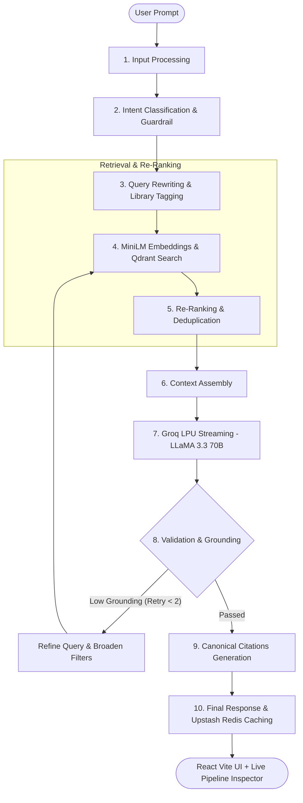

# DevAtlas AI 🌌

> **Elite Developer & AI Engineering Agent RAG Platform**  
> Powered by a 10-step Corrective RAG pipeline, live official documentation across 9 developer frameworks, Groq LPUs, free local embeddings, Qdrant vector search, and Upstash Redis.

---

## 🌟 Overview

**DevAtlas AI** is a production-grade AI assistant and Corrective RAG platform built exclusively for **Software Engineering, AI Agent Architectures, and Fullstack System Design**. 

Unlike generic chatbots, DevAtlas grounds its architectural intelligence directly in **9 official, verified documentation corpora** (React 19, Next.js App Router, Node.js, MDN Web Docs, LangChain, LangGraph, Groq, Qdrant, and Upstash), complete with a live 10-step telemetry inspector and clickable canonical source badges.

---

## ⚡ Key Features

- **10-Step Corrective RAG Pipeline (Self-RAG / CRAG)**:
  - Input normalization & language detection
  - Intent classification & technical scope guardrails
  - Query rewriting, coreference resolution & framework tag extraction
  - Zero-cost local MiniLM-L6-v2 vector embeddings
  - Qdrant Top-$K$ retrieval with payload metadata filtering
  - Semantic re-ranking, keyword boosting & chunk deduplication
  - Context assembly with dynamic token budgeting
  - High-throughput Groq LPU streaming inference (`llama-3.3-70b-versatile` & `llama-3.1-8b-instant`)
  - Grounding validation with automatic query refinement & retrieval retry loop
  - Canonical documentation citations with direct external links
- **9 Official Framework Documentation Corpora**:
  - **LangGraph JS**: StateGraph, Checkpointing, Multi-Agent Supervisors, Human-in-the-loop
  - **LangChain JS**: LCEL, Tool Calling, Runnables, Integrations
  - **Groq**: LPU Architecture, Models, Function Calling, Streaming
  - **Qdrant**: HNSW Vector Indexing, Distance Metrics, Payload Filtering
  - **Upstash**: Serverless Redis, Semantic Caching, Ratelimiting, QStash
  - **React 19**: Actions, `useActionState`, `useOptimistic`, Server Components
  - **Next.js**: App Router, Server Actions, Cache Revalidation
  - **Node.js**: Streams, Async Iterators, Worker Threads, Buffers
  - **MDN Web Docs**: Server-Sent Events (SSE), WebSockets, Fetch API
- **Zero-Cost Out-of-the-Box Defaults**:
  - **Free Local Embeddings**: Runs `@xenova/transformers` (`all-MiniLM-L6-v2`) locally in Node.js on CPU with zero API costs and disk caching.
  - **Embedded Vector Store**: Built-in high-performance Cosine Vector Store with payload filtering, plus optional remote Qdrant connection.
  - **Built-in Cache**: High-speed in-memory LRU cache fallback for Upstash Redis.
  - **Interactive Simulation Mode**: Immediate out-of-the-box testing even before adding an API key.
- **Oceanic Slate-Teal Glassmorphic Interface**:
  - React 19 + Vite (pure JavaScript JSX).
  - Oceanic deep slate-teal gradient (`#09202a` to `#165366`) with orbital indigo connection rings.
  - Live 10-Step Pipeline Telemetry Drawer showing latencies, grounding scores, and stage details in real time.

---

## 🏗️ Architecture



---

## 📂 Project Structure

```
c:\Users\jamsh\OneDrive\Desktop\AI/
├── README.md                            # Project documentation
├── IMPLEMENTATION.md                    # Deep-dive 10-stage RAG technical specification
├── package.json                         # Root project orchestrator
├── data collection/                     # The 9 official documentation collectors
│   ├── package.json                     # Crawler dependencies: cheerio, turndown
│   ├── collect-all.mjs                  # CLI orchestrator (--quick, --only, --all)
│   ├── seed-starter-corpora.mjs         # Initial starter corpora generator
│   ├── fetch-react-docs.mjs             # React 19 doc collector
│   ├── fetch-nextjs-docs.mjs            # Next.js doc collector
│   ├── fetch-node-docs.mjs              # Node.js API doc collector
│   ├── fetch-mdn-docs.mjs               # MDN standards doc collector
│   ├── fetch-langchain-docs.mjs         # LangChain JS doc collector
│   ├── fetch-landgraph-docs.mjs         # LangGraph JS doc collector
│   ├── fetch-groq-docs.mjs              # Groq LPU doc collector
│   ├── fetch-qdrant-docs.mjs            # Qdrant Vector DB doc collector
│   ├── fetch-upstash-docs.mjs           # Upstash Redis doc collector
│   └── out/                             # Generated Markdown corpora & manifests
│       ├── react/
│       ├── nextjs/
│       ├── groq/
│       ├── qdrant/
│       ├── upstash/
│       ├── langchain/
│       ├── langgraph/
│       ├── node/
│       └── mdn/
├── server/                              # Node.js backend
│   ├── package.json
│   ├── .env.example
│   └── src/
│       ├── index.js                     # Express app & server startup
│       ├── config.js                    # Central configuration & defaults
│       ├── services/
│       │   ├── embeddings.js            # @xenova/transformers (all-MiniLM-L6-v2)
│       │   ├── qdrant.js                # Qdrant client + Cosine Vector Store
│       │   ├── cache.js                 # Upstash Redis + LRU memory fallback
│       │   ├── groq.js                  # Groq client (LLaMA 3.3 70B & 3.1 8B)
│       │   └── guardrails.js            # Domain scope classifier
│       └── rag/
│           ├── ingest.js                # Ingestion service for data collection/out/
│           ├── pipeline/                # Modular 10-step pipeline
│           │   ├── 01_inputProcessor.js
│           │   ├── 02_intentClassifier.js
│           │   ├── 03_queryEnhancer.js
│           │   ├── 04_retriever.js
│           │   ├── 05_reranker.js
│           │   ├── 06_contextAssembler.js
│           │   ├── 07_generator.js
│           │   ├── 08_validator.js      # Corrective RAG reflection & retry loop
│           │   ├── 09_citationBuilder.js
│           │   └── orchestrator.js      # Coordinates all 10 stages & telemetry
│           └── routes/
│               ├── chat.js              # POST /api/chat & SSE /api/chat/stream
│               ├── knowledge.js         # GET /api/knowledge & POST /api/knowledge/sync
│               └── health.js            # GET /api/health & POST /api/health/settings
└── client/                              # React Vite JS frontend
    ├── package.json
    ├── vite.config.js                   # Vite config with backend proxy
    ├── index.html                       # Fonts: Outfit, Inter, JetBrains Mono
    └── src/
        ├── main.jsx                     # Entry point
        ├── App.jsx                      # Main layout orchestrator
        ├── index.css                    # Slate-teal gradient & glassmorphism
        ├── services/
        │   └── api.js                  # SSE stream consumer & API helper
        └── components/
            ├── Header.jsx               # Brand, model selector, health pill
            ├── Sidebar.jsx              # Framework filter chips, session history
            ├── ChatView.jsx             # Messages & 4 starter architecture cards
            ├── ChatMessage.jsx          # Markdown, syntax highlight, source badges
            ├── ChatInput.jsx            # Prompt composer with framework pills
            ├── PipelineVisualizer.jsx   # 10-step live telemetry inspection drawer
            ├── KnowledgeModal.jsx       # Framework document explorer
            └── SettingsModal.jsx        # API keys configuration
```

---

## 🚀 Quick Start

### 1. Install All Dependencies
From the root directory:
```bash
npm run install:all
```

### 2. Configure Environment (Optional)
The server works out-of-the-box with zero mandatory setup. To enable live Groq LPU inference, add your free key in `server/.env` or in the UI Settings dialog:
```env
# server/.env
PORT=5001
GROQ_API_KEY=gsk_your_free_key_here
GROQ_PRIMARY_MODEL=llama-3.3-70b-versatile
GROQ_FAST_MODEL=llama-3.1-8b-instant

# Optional remote services (leave empty to use built-in local stores)
QDRANT_URL=
UPSTASH_REDIS_REST_URL=
UPSTASH_REDIS_REST_TOKEN=
```

### 3. Run Application
```bash
# Starts both Backend (Port 5001) and Frontend (Port 5173)
npm run dev
```

- **Frontend Application**: [http://localhost:5173](http://localhost:5173)
- **Backend Health Check**: [http://localhost:5001/api/health](http://localhost:5001/api/health)

---

## 📚 Managing Documentation Corpora

To crawl or refresh documentation from the official GitHub repositories and docs sites:

```bash
# Run quick collection (LangGraph, Groq, Qdrant, Upstash, React)
npm run docs:collect

# Run a specific collector
cd "data collection"
node collect-all.mjs --only langgraph
node collect-all.mjs --only react

# Index/re-seed corpora into the vector store
npm run docs:seed
```

---

## 📡 API Reference

### `POST /api/chat/stream` (SSE Streaming)
Streams tokens, live telemetry events, and verified citations:
```json
{
  "query": "How do I build a persistent agent using LangGraph StateGraph?",
  "history": [],
  "filter": "langgraph",
  "model": "llama-3.3-70b-versatile"
}
```

**SSE Events Emitted**:
- `event: telemetry`: Stage metrics (Stage 1 to 10 latencies, detected frameworks, word count).
- `event: citations`: Array of verified canonical documentation URLs.
- `event: token`: Chunked text delta tokens.
- `event: done`: Final pipeline completion metadata.

### `GET /api/knowledge`
Returns indexed vector counts and metadata manifests across the 9 framework corpora.

### `GET /api/health`
Returns live status for local Embeddings, Vector Store, Upstash Redis, and Groq LPU services.

---

## 📄 License
MIT © 2026 DevAtlas AI. Documentation content is attributed to official documentation sources under their respective open licenses.
