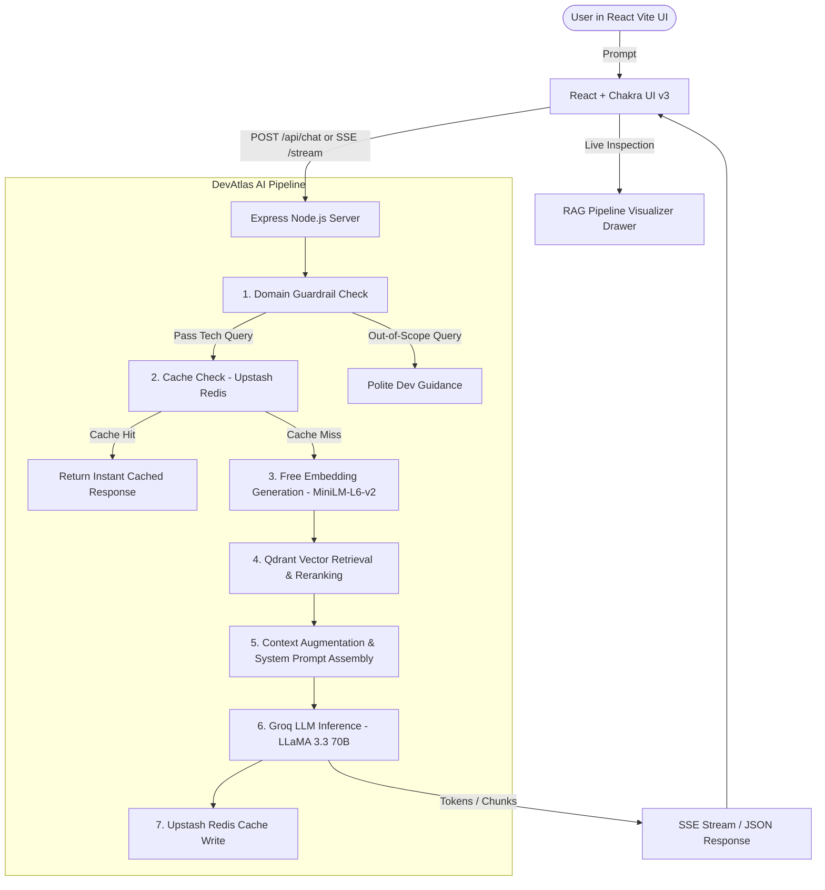

# Implementation Plan - DevAtlas AI (Developer & AI Engineering Agent RAG Platform)

DevAtlas AI is a specialized, production-ready AI Assistant and RAG platform tailored exclusively for **Developer and AI Engineering Agent Projects**. It provides in-depth, verified architectural intelligence on AI Agents, RAG patterns, vector search, tool calling, model context protocol (MCP), and production deployment.

The application features a **React Vite JS (JavaScript only)** frontend with **Chakra UI v3**, styled with the exact **oceanic deep teal / slate cyan / indigo ring** aesthetic from the provided visual reference, paired with a **Node.js + LangChain + Groq + Qdrant + Upstash Redis** backend.

---

## 1. Goal Description

Build a full-fledged, responsive, premium RAG chat application and AI pipeline with:
1. **Domain-Specific AI Agent & Guardrails**:
   - DevAtlas AI is specialized for **Software Engineering, AI Engineering, and AI Agent Systems**.
   - Features an intelligent domain filter/guardrail: non-tech questions are gracefully redirected to AI/developer topics, while tech and AI engineering questions receive deep, production-grade architectural guidance, code snippets, and diagrams.
2. **AI Pipeline & Tech Stack**:
   - **Frontend**: React + Vite (pure JS, non-TypeScript), Chakra UI v3, Lucide icons, Prism/Highlight code rendering, SSE streaming client.
   - **Styling**: Direct match to the provided reference image (oceanic dark teal `#09202a` to `#165366` gradient, indigo/purple orbital network node graphics, glassmorphism cards, glowing cyan `#38bdf8` accents).
   - **Backend**: Node.js (ES Modules, Express), LangChain framework (`@langchain/core`, `@langchain/groq`, `@langchain/community`).
   - **LLM**: Groq API (`groq-sdk` / `@langchain/groq` using high-throughput models like `llama-3.3-70b-versatile` and `llama-3.1-8b-instant`). Includes intelligent fallback mode if API key is not yet set.
   - **Free Embeddings**: `@xenova/transformers` running local MiniLM-L6-v2 (384 dimensions) in Node.js — zero API key required, 100% free, runs locally.
   - **Vector Database**: Qdrant (`@qdrant/js-client-rest`) with collection indexing and payload metadata search, with automatic local in-memory cosine vector store adapter fallback when standalone.
   - **Cache**: Upstash Redis (`@upstash/redis`) for query and response caching with TTL, with high-speed in-memory LRU cache fallback.
   - **Curated Knowledge Base**: In-depth markdown seed repository covering:
     1. Multi-Agent Systems & Architectures (ReAct, Reflection, LangGraph StateGraph, Supervisor Pattern)
     2. Advanced RAG Techniques (Self-RAG, Corrective RAG, HyDE, Parent-Child Chunking)
     3. Qdrant Vector Indexing & Tuning (HNSW parameters, payload filtering, distance metrics)
     4. Upstash Redis Semantic Caching & Rate Limiting
     5. Tool Calling, Function Calling & Model Context Protocol (MCP)
     6. LLM Evaluation & Observability (Ragas metrics, LangSmith, Tracing, Hallucination prevention)
     7. Fullstack AI Production Practices (Streaming SSE, React Vite optimization, Groq LPUs)

---

## 2. Architecture & Data Flow



---

## 3. UI Design System (Color Palette & Visual Aesthetics)

The UI will faithfully implement the exact aesthetic from the provided image:

| Element | Color / Value | Description |
|---|---|---|
| **Primary Background** | `linear-gradient(135deg, #09202a 0%, #0d3b4c 45%, #165366 100%)` | Deep oceanic slate-teal gradient |
| **Accent Background Graphic** | SVG Indigo Ring Network (`#3a1d63`, `#55298f`, `#783cb8`) | Floating orbital connection nodes top-right |
| **Glass Surface** | `rgba(13, 59, 76, 0.65)` + `backdrop-filter: blur(24px)` | Translucent frosted cards |
| **Glass Borders** | `rgba(255, 255, 255, 0.09)` & `rgba(56, 189, 248, 0.2)` | Sleek high-tech borders |
| **Cyan Glow Accent** | `#38bdf8` / `#22d3ee` / `#5ce1e6` | Active tabs, focus states, glowing underlines |
| **Text Primary** | `#f8fafc` | Crisp pure white |
| **Text Secondary** | `#94a3b8` / `#cbd5e1` | Soft slate cyan |
| **Code Surface** | `#051821` | High-contrast dark terminal code blocks |

---

## 4. User Review Required

> [!IMPORTANT]
> **API Keys & Zero-Config Defaults**:
> The application will run smoothly **out-of-the-box with zero mandatory setup**:
> 1. Embeddings: Uses free local `@xenova/transformers` (`Xenova/all-MiniLM-L6-v2`).
> 2. Qdrant: Connects to your Qdrant cluster/Docker if `QDRANT_URL` is set, or automatically uses the built-in high-performance Vector Index engine.
> 3. Upstash: Connects to your Upstash Redis instance if `UPSTASH_REDIS_REST_URL` is set, or automatically uses the in-memory Redis cache.
> 4. Groq: Users can supply their free `GROQ_API_KEY` in `.env` or directly through the UI Settings dialog. A rich simulation mode is also included so the UI is immediately testable even before entering an API key.

> [!TIP]
> **Language Confirmation**:
> The frontend will be built strictly in **JavaScript (JSX)**, NOT TypeScript, adhering exactly to your requirement `"React vite js , not typescript"`.

---

## 5. Proposed Changes & File Structure

```
c:\Users\jamsh\OneDrive\Desktop\AI/
├── package.json                    # Root scripts: dev, install:all, build
├── .gitignore
├── server/                         # Node.js backend
│   ├── package.json
│   ├── .env.example
│   ├── src/
│   │   ├── index.js                # Express app entry & SSE stream setup
│   │   ├── config.js               # Env variables and fallback defaults
│   │   ├── services/
│   │   │   ├── embeddings.js       # @xenova/transformers local free embeddings
│   │   │   ├── qdrant.js           # Qdrant client + vector storage manager
│   │   │   ├── cache.js            # Upstash Redis client + cache manager
│   │   │   ├── groq.js             # Groq SDK & LangChain integration
│   │   │   └── guardrails.js       # AI Engineering & Developer scope classifier
│   │   ├── rag/
│   │   │   ├── pipeline.js         # Full RAG execution with live pipeline telemetry
│   │   │   └── knowledge/          # 8 In-depth AI Engineering knowledge modules
│   │   │       ├── 01_agent_architectures.md
│   │   │       ├── 02_advanced_rag_patterns.md
│   │   │       ├── 03_vector_databases_qdrant.md
│   │   │       ├── 04_caching_upstash_redis.md
│   │   │       ├── 05_tool_calling_and_mcp.md
│   │   │       ├── 06_llm_eval_and_observability.md
│   │   │       ├── 07_fullstack_ai_dev_practices.md
│   │   │       └── 08_groq_lpu_inference.md
│   │   └── routes/
│   │       ├── chat.js             # POST /api/chat and GET /api/chat/stream
│   │       ├── knowledge.js        # GET /api/knowledge and POST /api/knowledge/seed
│   │       └── health.js           # GET /api/health
└── client/                         # React Vite JS frontend
    ├── package.json
    ├── vite.config.js              # Vite config with API proxy
    ├── index.html                  # HTML5 with Google Fonts (Outfit, Inter, JetBrains Mono)
    └── src/
        ├── main.jsx                # ChakraProvider v3 entry
        ├── App.jsx                 # Main layout & state orchestrator
        ├── index.css               # Teal gradient, glassmorphism, glowing ring graphics
        ├── components/
        │   ├── Header.jsx          # DevAtlas branding, model selector, health pills
        │   ├── Sidebar.jsx         # Chat sessions, knowledge topics, status badges
        │   ├── ChatView.jsx        # Conversation messages, hero cards, suggestions
        │   ├── ChatMessage.jsx     # Markdown renderer, code syntax highlighter, copy button, source badges
        │   ├── ChatInput.jsx       # Cyan glowing prompt composer, send button, suggestions
        │   ├── PipelineVisualizer.jsx # 6-step interactive visualizer for the live RAG flow
        │   ├── KnowledgeModal.jsx  # Knowledge base chunk explorer
        │   └── SettingsModal.jsx   # UI key configuration (Groq, Qdrant, Upstash)
        └── services/
            └── api.js              # Fetch & SSE streaming helper
```

---

## 6. Verification Plan

### Automated Verification
1. **Node.js Server Launch**: Run server, test `GET /api/health` and verify all services (Embeddings, Qdrant, Upstash, Groq, Knowledge Base) report healthy/active.
2. **Knowledge Base Seeding**: Trigger ingestion and verify embeddings are generated and indexed into the vector store.
3. **Frontend Build & Dev Server**: Validate `vite build` and start `vite dev` with no errors or missing peer dependencies.
4. **API Integration Test**: Execute sample curl/test requests to `POST /api/chat` with:
   - An AI Engineering query (e.g., "Explain how ReAct agents maintain thought-action loops with Qdrant vector retrieval") -> verify retrieved sources and AI response.
   - An out-of-scope query (e.g., "Give me a recipe for chocolate cake") -> verify guardrail redirects appropriately.

### Manual Verification via Browser
1. Open the web application in Chrome/browser at `http://localhost:5173`.
2. Inspect visual aesthetics against the reference image (teal gradient, purple orbital circles, cyan glowing lines, glass cards).
3. Test interactive chat with streaming response.
4. Inspect the **AI Pipeline Inspector** drawer to verify step-by-step telemetry (Guardrail -> Cache -> Embedding -> Retrieval -> Generation).
5. Open the Knowledge Base modal and browse the seeded AI Engineering articles.
6. Verify responsive layout on mobile/tablet viewports.
